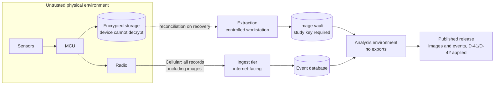

# Threat Model — Project Breadcrumbs

**Status:** Proposed. Requires security and legal review before field use.
**Companion documents:** [`../review/DESIGN_REVIEW_R1.md`](../review/DESIGN_REVIEW_R1.md), [`DATA_PROTECTION_CONTROLS.md`](DATA_PROTECTION_CONTROLS.md), [`../design/HARDENING_PLAN.md`](../design/HARDENING_PLAN.md)

## 1. Why this document exists

`PRIVACY_SAFETY_AND_REVIEW.md` lists risks as policy commitments. Commitments are necessary but they are not a design. This document asks a different question: **who would want to break this system, what would they get, and what specifically stops them?**

The honest framing is that this project creates a small number of things worth attacking, on property belonging to volunteers, containing images of people who did not consent. That is a modest but genuinely sensitive asset, and it deserves a threat model rather than a checklist.

## 2. Scope and method

**In scope:** the physical module, its firmware behaviour, the recovery and ingest workflow, the research dataset, the participant relationship, and the project's public communications.

**Out of scope:** general internet-facing infrastructure hardening beyond the controls in Data Protection Controls; personnel screening; physical security of the project office.

**Method:** enumerate assets, enumerate actors, trace the paths between them, then assign a mitigation and a residual risk. Where a residual risk cannot be mitigated at reasonable cost, it is stated as accepted rather than quietly dropped. This is a lightweight STRIDE-informed review adapted for a privacy-sensitive physical system, not a formal security certification.

## 3. Assets

| ID | Asset | Why it matters | Sensitivity |
|---|---|---|---|
| A-01 | Participant identity linked to a `participant_code` | Disclosure identifies a household that took part in a crime-observation study | High |
| A-02 | Participant home address | Physical safety, retaliation, targeting | Critical |
| A-03 | Captured images | Images of unconsenting people, potentially children; could enable identification | Critical |
| A-04 | Timing and event records | Can reconstruct when a household was empty, or when nobody was home | High |
| A-05 | Location observations | Movement of a device; if misinterpreted, becomes a person-tracking record | High |
| A-06 | Device keys and firmware signing keys | Compromise allows forged records or a rogue imaging device | Critical |
| A-07 | Consent records and their versions | Legal defensibility of the entire study | High |
| A-08 | Recovery and reward records | Links a device to a person who returned it | High |
| A-09 | Aggregate dataset and analysis scripts | Reproducibility; re-identification risk if too granular | Medium |
| A-10 | Project credibility and the participants' trust | Non-recoverable if damaged | Critical |

The ordering matters: A-02 and A-10 are the assets that can end the project, and neither is a technical control problem. They are addressed by operational policy in the mitigations below.

## 4. Actors

| ID | Actor | Capability | Motivation |
|---|---|---|---|
| X-01 | Opportunistic thief | Takes a package; may open it later; may discard the device | Opportunistic gain |
| X-02 | Organised porch-theft group | Repeat visits, may recognise devices, may return to a site | Sustained gain |
| X-03 | The photographed person | Has been recorded; may later learn of it | Avoid identification; retaliate |
| X-04 | Participant (careless) | Re-aims the device, photographs a screen with a phone, discusses deployments publicly | Convenience |
| X-05 | Participant (adversarial) | Joins to surveil a neighbour, or to obtain reward money | Personal advantage |
| X-06 | Bystander or neighbour | Is in the field of view without consent | Complaint, legal action |
| X-07 | Insider researcher | Legitimate dataset access | Curiosity, side interest, coercion |
| X-08 | Buyer of a stolen module | Possesses the device and its storage | Curiosity, resale, notoriety |
| X-09 | Network or server attacker | Compromises ingest or storage | Data theft, disruption |
| X-10 | Law enforcement or litigation | Valid legal process | Evidence |
| X-11 | Journalist or activist | Public-interest scrutiny | Publication, criticism |
| X-12 | Malicious public actor reading the repo | Knows exactly what the device looks like and how it behaves | Defeat the device; target participants |

X-12 is unusual and is created entirely by the project's own decision to publish. It is addressed in §8.

## 5. Threat register

| ID | Threat | Path | Impact | Likelihood | Mitigation | Residual |
|---|---|---|---|---|---|---|
| T-01 | Stolen device discloses prior images | X-01/X-08 possesses storage | Critical | High | Images encrypted at rest with a key the device cannot use alone (sealed box to study key); crypto-shred on retirement. See DPC §4 | Low, if implemented before field use |
| T-02 | Device becomes a beacon that tracks the participant | X-08 or a finder powers it on while it still reports | High | Medium | The device reports location by design (D-32), so this is accepted rather than suppressed. Mitigations are publication precision and delay (D-41), fixed mounting inside the package, and no externally visible indicator | Medium–high, accepted |
| T-03 | Remote activation of the camera | X-09 or an insider issues a capture command | Critical | Low | No remote-capture command exists in firmware. This is an architectural exclusion, not a policy | Low |
| T-04 | Participant re-aims the camera at a neighbour | X-05 | Critical | Medium | Camera geometry fixed at assembly; FOV bounded mechanically; tamper-evident mount; re-aim voids the deployment and triggers review | Medium |
| T-05 | Image shared outside the project before release, or released outside the approved process | X-07, X-04 | Critical | Medium | Publication is intended (D-40), so the control is timing and framing rather than secrecy: two-person rule before release, captions fixed by D-42, no pre-release export, access log review | Medium |
| T-06 | Image leaked via screen photograph or personal device | X-04, X-07 | Critical | High | Images viewable only in a controlled viewer that blocks download; no personal devices in the image review session; explicit prohibition with audit | Medium |
| T-07 | Return label reveals the participant's address | X-01 | Critical | Medium | Return path routes to a project PO box; no participant address on or in the device; no participant name | Low |
| T-08 | Public documentation lets a thief recognise and defeat the device | X-12 | High | High | Publish science, withhold device fingerprint (§8). No enclosure photos, dimensions, reward terms, or label designs in the public repo | Medium |
| T-09 | Subpoena or legal demand for images | X-10 | Critical | Medium | Recorded law-enforcement position (DPC §7); notify participants unless legally barred; minimise what exists to be demanded | Medium |
| T-10 | Participant retaliation after a captured event | X-03 | Critical | Medium | Participants instructed never to confront or post; no device-identifying markings; safety briefing at onboarding; immediate suspension on any threat | Medium |
| T-11 | Insider exfiltration | X-07 | Critical | Medium | Named access, MFA, no bulk query capability, quarterly access log review, revocation drill | Medium |
| T-12 | Server compromise | X-09 | Critical | Low | Encryption at rest, least-privilege credentials, no images on the internet-facing ingest tier, separate analysis environment | Medium |
| T-13 | Re-identification from combined fields | X-11 | High | Medium | Site-level cells suppressed below n = 5; no cross-tabs on `site_code`; participant location coarsened and delayed (D-41). Event-level records are published by design (D-40), so protection rests on removing participant identifiers rather than on aggregating events | Medium |
| T-14 | Device reprogrammed and repurposed after theft | X-08 | Medium | Medium | Secure boot, signed firmware, debug access disabled in production units | Low |
| T-15 | Device discovered by its illumination or RF signature | X-01 | High | Medium | No visible IR when avoidable; no status LED during deployment; RF duty cycle minimised; device appearance indistinguishable from ordinary contents | Medium |
| T-16 | Reward fraud | X-01/X-05 | Medium | High | Reward is for hardware return only, never for information; no identity requirement beyond a collection point; track claimed-return as a data-quality flag | High (accepted) |
| T-17 | Participant feedback data re-identifies a household | X-11 | Medium | Medium | Store qualitative notes as coded summaries, not verbatim quotes with place names | Low |
| T-18 | The operating base is identified and targeted | X-01/X-02 read the repository or see volunteers collecting boxes at one address | Critical | Medium | The base address is never published here or in any public record; collection is by appointment; modules are not stored there in quantity; no signage | Medium |

## 6. The central tension: observation versus privacy

Three architectures are possible. Only one is currently written down anywhere in the repository, and it is not the one the documents imply.

| | **Tier A — no transmission** | **Tier B — metadata only** | **Tier C — images transmitted** |
|---|---|---|---|
| What leaves the device | Nothing until physical recovery | Event type, time, module ID, coarse state | Full images over the air |
| Primary observation survives device loss | **No** | **Yes, for timing and trigger class** | Yes, including imagery |
| Remote imaging capability created | No | No | **Yes — a camera in someone's garden** |
| Breach impact | Ciphertext only | Timestamps and presence | Identifiable images |
| Power cost | Lowest | Moderate (radio wakes) | High |
| Cost per module | Lowest | Moderate | Highest |
| Recovery-time measurement | Only if device returns | **Yes** | Yes |
| Legal exposure of the project | Lowest | Low | Highest |

**Recommendation: Tier B — superseded 2026-10-30.** The owner chose Tier C in substance: cellular transmission of all records, images included (D-33). Two of the objections to Tier C above no longer apply as written. Bursts are small and infrequent, so the power and cost penalty is modest rather than high. And no remote imaging capability is created, because no command path exists at all (T-03, HW-30). The objection that survives is breach exposure, which is now governed by publication decisions — D-40 (public release), D-41 (location precision), D-42 (caption standard) — rather than by withholding data.

The property worth preserving from Tier B is the one that made it attractive: no image leaves the device except as part of an event the device itself generated. That is architectural rather than a policy, and it is what keeps this from becoming a remote camera on someone's porch.

## 7. Trust boundaries and data flow

Trust boundaries, in order of importance:

1. **Module ↔ outside world.** The device is hostile territory the moment it leaves the participant's porch. Nothing on it should be readable without a key held elsewhere.
2. **Ingest ↔ image vault.** Images pass through the internet-facing tier in transit, so ingest must not retain them: each is written to the vault and dropped from the request path, with no local buffering.
3. **Analysis ↔ publication.** Publication is irreversible. Suppression must be applied by code, not by reviewer discipline alone.
4. **Participant ↔ project records.** Contact data is a separate store from event data, joined only by a mapping held by the lead.

## 8. Publication and operational security

The repository is public, which is the right default for a research project and the wrong default for a device description. A thief who can recognise the module simply discards it, and the pilot then measures discards rather than theft — a silent validity failure that looks like a low event rate.

**Publish:** purpose, protocol, data model, analysis plan, aggregate results, limitations, and this threat model.

**Withhold from the public repository:** enclosure photographs and dimensions, mounting method, indicator behaviour, battery location, reward wording and value, return-label design, and any photograph of a deployed module.

**Rule of thumb:** publish what a reader needs to *audit the science*, withhold what a reader needs to *identify the device*. Keep the operational annex in a private repository with the same careful revision practice.

## 9. Stop rules

A pilot that cannot pause itself is not a pilot. The following triggers an immediate pause of all deployments until written reinstatement by the named lead. Each pause is logged with date, trigger, actions, and decision.

| ID | Trigger | Pause scope | Reinstatement authority |
|---|---|---|---|
| SR-01 | Any image accessed outside the approved access list | All deployments | Lead + reviewer, after access re-audit |
| SR-02 | Any image or event record shared outside the approved release process, or published without the D-41 and D-42 filters applied | All deployments | Lead + legal, after incident review |
| SR-03 | Any participant reports feeling unsafe, threatened, or targeted | That site immediately; all sites if cause is systemic | Lead |
| SR-04 | Any bystander or neighbour complaint about imaging | All deployments at that site | Lead + reviewer |
| SR-05 | Device exceeds thermal or battery specification in the field | All deployments using that hardware revision | Lead + hardware owner |
| SR-06 | Device found transmitting when policy says it should not | All deployments | Lead + security review |
| SR-07 | Device found trivially spoofable or remotely imageable | All deployments | Lead + security review |
| SR-08 | Participant attempts recovery, pursuit, or contact with a suspected taker | That participant, permanently | Lead only |
| SR-09 | A published image is found to depict a minor, or someone with no connection to the opening, meaning the D-52 filter failed | All deployments until the filter is re-verified | Lead + reviewer |
| SR-10 | Loss of the study private key, or suspected compromise | All deployments | Lead + full key rotation |

SR-06 and SR-07 are the ones most likely to be rationalised away under deadline pressure. They should be treated as non-discretionary.

## 10. Residual risk statement

After the mitigations above, the following risks remain and are accepted by the project lead, with a date and signature, before Phase 1:

- A device may be found and destroyed; the loss is unrecoverable and is counted as an outcome, not a failure.
- A participant may be identified by a combination of circumstances outside the project's control.
- Reward-driven returns will contaminate recovery-time data in ways that cannot be fully corrected.
- Some proportion of triggered events will capture a person who did nothing wrong.
- Publication of any result at all carries a risk of being read as a claim about crime in a specific neighbourhood, despite every disclaimer.

If any of these is not acceptable, the correct response is to change the design, not to add a paragraph.

## 11. What this model does not cover

- Legal compliance in any specific jurisdiction. See `PRIVACY_SAFETY_AND_REVIEW.md` §8 and Data Protection Controls §7.
- Institutional ethics review outcomes.
- Physical security of the project office or staff.
- Supply-chain trust in the hardware vendor.
- Long-term archival after study close, beyond the disposition rule in Data Protection Controls §5.
